# 256-Bit (16 × 16) Custom CMOS SRAM Integrated Circuit

Full custom transistor-level design, physical layout, and parasitic-extracted verification of a **256-bit (16 rows × 16 columns) Static Random-Access Memory (SRAM) Integrated Circuit** implemented in **TSMC 0.18 µm CMOS** ($V_{\text{DD}} = 1.8\text{ V}$, $\lambda = 90\text{ nm}$) using **Electric VLSI 9.08** and **LTspice XVII**.

The chip interfaces with the outside world through strictly **five digital signals** (plus power and ground) and includes complete on-chip address generation, self-timed control logic, precharge circuitry, write drivers, sense amplifiers, multi-stage input/output buffers, and full bond wire/pad RLC packaging models.

---

## 1. Top-Level Physical Layout

The full-chip physical layout integrates the 256-bit core array, row decoders, column multiplexers, shift registers, synchronous counter, control logic, precharge units, write drivers, sense amplifiers, input buffers, and size-32 fingered output buffers.

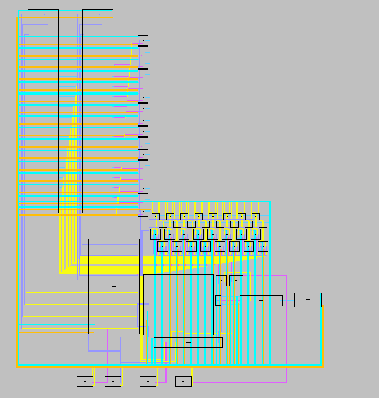

* **Dimensions & Area:** Full custom compact floorplan pitch-matched across rows and columns.
* **Routing Purity:** 100% strictly perpendicular / Manhattan geometry (zero diagonal arcs).
* **DRC & LVS Status:** **0 DRC violations**, **0 DRC warnings** (verified via Electric Quick DRC engine), and **100% LVS / NCC match** (topology, exports, and transistor sizing).

---

## 2. External Interface & Pinout

The chip features a pin-constrained interface requiring only **5 external digital pins** to access all 256 memory locations:

```
                  +--------------------------------+
                  |   256-Bit (16x16) CMOS SRAM    |
                  |                                |
  [PAD] CLK       |---> CLK                   DOUT |---> DOUT [PAD]
  [PAD] CTRL      |---> CTRL (R/W)                 |
  [PAD] ADDR_IN   |---> ADDR_IN                    |
  [PAD] DIN       |---> DIN                        |
                  |                                |
  [PAD] VDD       |=== VDD (1.8V)                  |
  [PAD] GND       |=== GND (0.0V)                  |
                  +--------------------------------+
```

### Pin Description

| Pin Name | Type | Direction | Description |
|:---|:---:|:---:|:---|
| **`CLK`** | Digital | Input | Master clock input ($100\text{ MHz}$, $T = 10\text{ ns}$). Synchronizes address shifting, precharge, and data latching. |
| **`CTRL`** | Digital | Input | Operation mode select: **`0 V` (LOW) = Write Mode**, **`1.8 V` (HIGH) = Read Mode**. |
| **`ADDR_IN`** | Digital | Input | 1-bit serial address input. Shifts in an 8-bit address over 8 clock cycles to address any of the 256 cells. |
| **`DIN`** | Digital | Input | 1-bit serial write data input presented to the differential write driver. |
| **`DOUT`** | Digital | Output | 1-bit latched read data output driven by a high-drive size-32 output buffer. |
| **`VDD`** | Power | Supply | Core power supply: nominal $1.8\text{ V}$ DC. |
| **`GND`** | Ground | Reference | Core ground reference: $0.0\text{ V}$ DC. |

---

## 3. Architecture & Functional Operation

```
                             +------------------------+
                             |       CLK (100 MHz)    |
                             +-----------+------------+
                                         |
                         +---------------+---------------+
                         |                               |
                 +-------v--------+              +-------v--------+
  ADDR_IN ------>| 8-Bit SIPO SReg|              |  3-Bit Counter |
                 +-------+--------+              +-------+--------+
                         |                               |
            +------------+------------+                  | COUNT_7 (Cycle 8)
            |                         |                  v
     RA[3:0]|                  CA[3:0]|          +---------------+
            v                         v          | Control Logic |<--- CTRL
     +--------------+          +--------------+  +-------+-------+
     | 4-to-16 Row  |          | 4-to-16 Col  |          | PCB, WL_EN,
     |   Decoder    |          |   Decoder    |          | WRITE_EN, READ_EN
     +------+-------+          +------+-------+          |
            | 16 WLs                  | 16 COLs          |
            v                         v                  |
     +----------------------------------------+          |
     |         16 x 16 6T SRAM Matrix         |          |
     |               (256 Bits)               |          |
     +-------------------+--------------------+          |
                         | 16 BL / BLB Pairs             |
                         v                               |
             +-----------------------+                   |
             | Precharge & Eq (x16)  |<------------------+ (PCB)
             +-----------+-----------+                   |
                         |                               |
                         v                               |
             +-----------------------+                   |
             | Column MUX (TG Array) |                   |
             +-----------+-----------+                   |
                         | Global Bitlines (GBL/GBLB)    |
                         +---------------+               |
                         |               |               |
                         v               v               |
                  +-------------+ +-------------+        |
   DIN ---------->|Write Driver | |  Sense Amp  |<-------+ (READ_EN)
   (WRITE_EN) --->+-------------+ +------+------+
                                         |
                                         v
                                  +-------------+
                                  | D Flip-Flop |<--- READ_CLK
                                  +------+------+
                                         |
                                         v
                                  +-------------+
                                  |Output Buffer|---> DOUT
                                  +-------------+
```

### Operation Protocol (8-Cycle Frame Architecture):
1. **Cycles 1–7 (Address Shift Phase):**
   * Rising edges of `CLK` shift 8 bits from `ADDR_IN` into the 8-bit SIPO shift register (`8Bit_shiftreg`).
   * The 3-bit synchronous counter (`3Bit_counter`) tracks cycles from `000` to `110`.
   * During the low phase of every clock cycle ($\text{CLK} = 0$), `PCB` pulses low to precharge all bitlines to $V_{\text{DD}}$.
2. **Cycle 8 (Execution Phase):**
   * The 8th address bit enters the shift register, forming the complete 8-bit address ($A_7..A_4$ for Row, $A_3..A_0$ for Column).
   * The counter reaches `111` (`COUNT_7 = 1`).
   * When `CLK` falls low at $t = 80\text{ ns}$ (or $160\text{ ns}$, $240\text{ ns}$, $320\text{ ns}$):
     * **Wordline Activation:** `WL_EN` pulses high, driving the selected row wordline (`WL`).
     * **Column Selection:** The column decoder enables the corresponding transmission-gate pair (`TG_bitline`), coupling the selected column bitlines to the global bitlines (`GBL`/`GBLB`).
     * **Write Mode (`CTRL = 0`):** `WRITE_EN` asserts; the write driver overpowers the cell to store `DIN`.
     * **Read Mode (`CTRL = 1`):** `READ_EN` activates the differential sense amplifier with matched delay, resolving the differential bitline voltage and clocking it into the output D flip-flop latch to appear on `DOUT`.

---

## 4. Subcircuit Schematics & Physical Layouts

### 4.1 6T SRAM Bitcell (`6T_cell`)
The bitcell uses an ultra-compact continuous shared-active-diffusion architecture ($45\lambda \times 72\lambda = 4.05\ \mu\text{m} \times 6.48\ \mu\text{m}$, representing an **89.9% area reduction** compared to conventional layouts).
* **Pull-down NMOS ($M_{\text{PD}}$):** $W = 0.63\ \mu\text{m}, L = 0.18\ \mu\text{m}$ (Cell Ratio $\text{CR} = 1.75$)
* **Access NMOS ($M_{\text{AX}}$):** $W = 0.36\ \mu\text{m}, L = 0.18\ \mu\text{m}$ (Pull-up Ratio $\text{PR} = 1.33$)
* **Pull-up PMOS ($M_{\text{PU}}$):** $W = 0.27\ \mu\text{m}, L = 0.18\ \mu\text{m}$

| Schematic | Physical Layout |
|:---:|:---:|
| 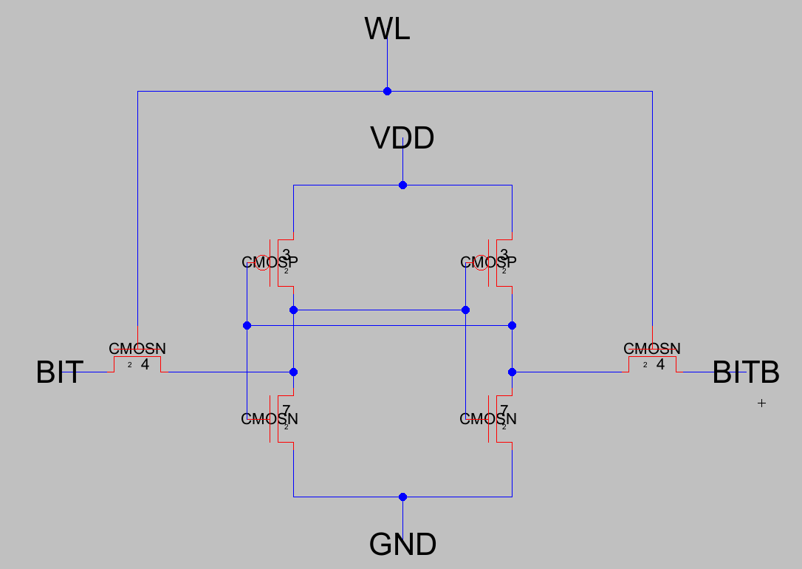 | 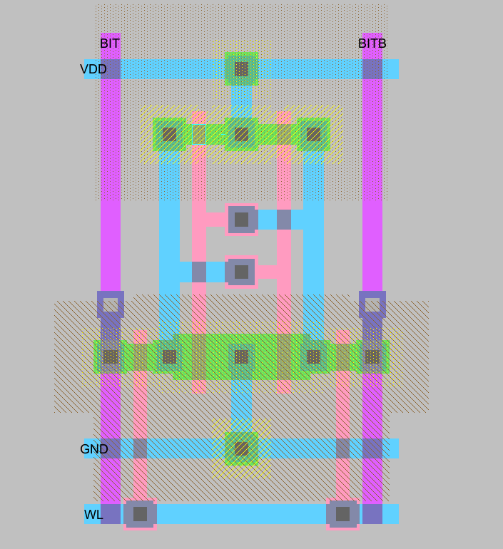 |

---

### 4.2 Precharge & Equalization Unit (`Precharge_ckt`)
A continuous shared-diffusion PMOS unit ($44\lambda \times 22\lambda$) with two pull-ups and one cross-equalizer transistor active low (`PCB = 0`) to precharge and balance bitlines to $1.8\text{ V}$ prior to read operations.

| Schematic | Physical Layout |
|:---:|:---:|
| 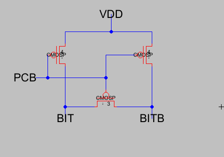 | 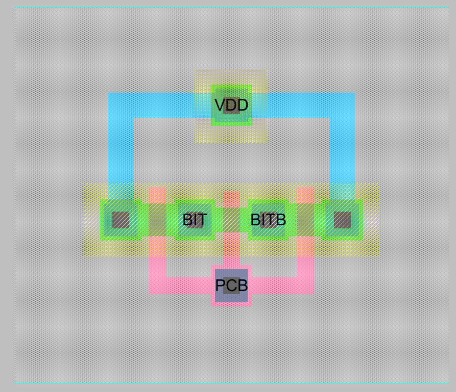 |

---

### 4.3 Tri-State Differential Write Driver (`Write_driver`)
Tri-state differential pull-down circuitry ($78\lambda \times 56\lambda$) controlled by `WRITE_EN`. Overpowers the bitcell latch during write mode while maintaining high impedance (Hi-Z) during read cycles to prevent read disturbance.

| Schematic | Physical Layout |
|:---:|:---:|
| 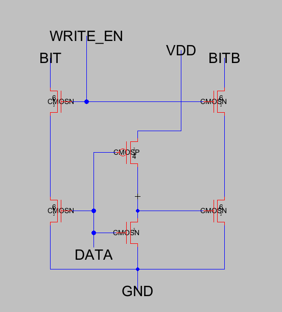 | 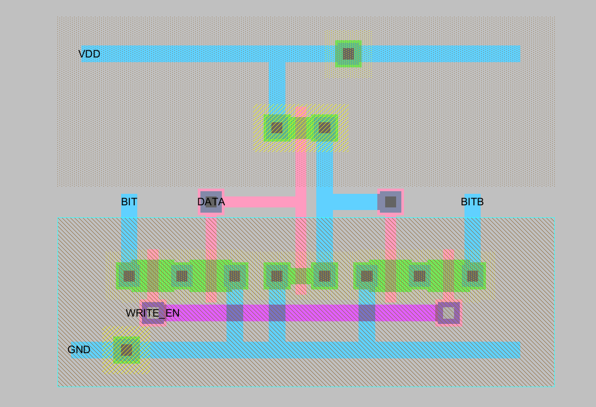 |

---

### 4.4 Differential Sense Amplifier (`Sense_amp`)
A high-gain current-mirror Operational Transconductance Amplifier (OTA) architecture ($62\lambda \times 56\lambda$) with zero DC bitline loading that resolves differential bitline swings down to $\Delta V \le 50 - 100\text{ mV}$ into full-rail CMOS output.

| Schematic | Physical Layout |
|:---:|:---:|
| 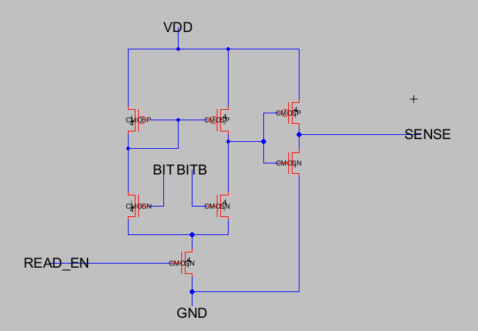 | 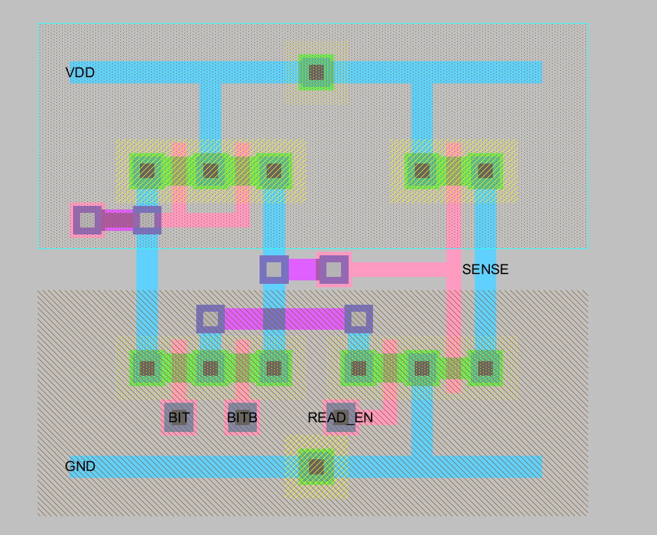 |

---

### 4.5 Master-Slave Transmission-Gate D Flip-Flop (`D_flipflop`)
Standard cell implementation ($287\lambda \times 56\lambda$) featuring 20 transistors (6 CMOS inverters + 4 transmission gates) with dedicated horizontal Metal-2 clock tracks. Used in the 8-bit address shift register, 3-bit counter, and output latch.

| Schematic | Physical Layout |
|:---:|:---:|
| 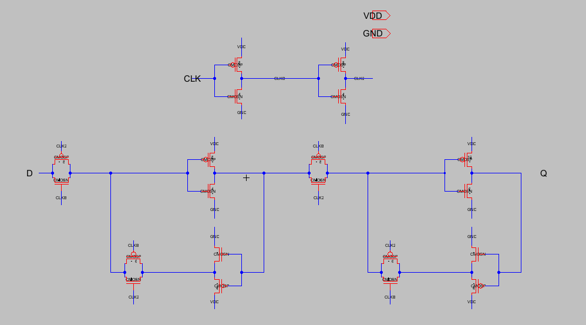 | 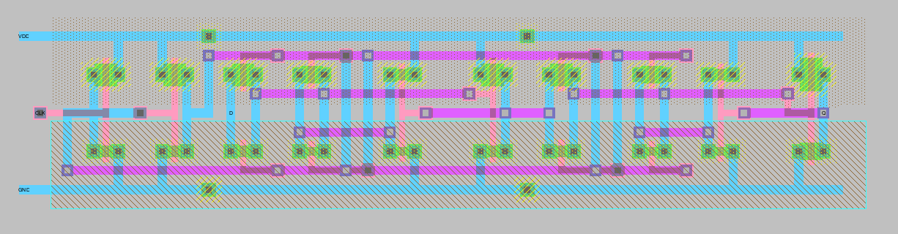 |

---

## 5. Packaging & I/O Pad Equivalent Model

To accurately reflect real-world silicon packaging, all 5 external signal pins and the 2 power rails are packaged through an equivalent **2-stage RLC ladder network** representing bond wire parasitics and pad capacitance:

```
PCB_TRACE o----/\/\/\----+----llll----+----/\/\/\----+----llll----+----o CIRCUIT (Die Pad)
              R1=0.10   |   L1=2.5n  |    R0=0.15   |   L0=2.0n  |
                        =            =              =            =
                  C1=700f      C0=1.2p        C1=700f      C0=1.2p
                        |            |              |            |
PCB_GND   o-------------+------------+--------------+------------+
```

* **Bond Wire Inductance:** $L_{\text{total}} = 4.5\text{ nH}$ ($2.5\text{ nH} + 2.0\text{ nH}$)
* **Bond Wire Series Resistance:** $R_{\text{total}} = 0.25\,\Omega$ ($0.10\,\Omega + 0.15\,\Omega$)
* **Pad Shunt Capacitance:** $C_{\text{pad}} = 1.9\text{ pF}$ ($1.2\text{ pF} + 0.7\text{ pF}$)
* **PCB Source Series Termination:** $R_{\text{ser}} = 50\,\Omega$ on all external driving sources (`VCLK`, `VADDR`, `VCTRL`, `VDIN`).
* **Output Load:** $C_{\text{dout}} = 20\text{ fF}$ load on `DOUT_PCB`.

---

## 6. Verification Results & Characterization

Simulations were performed end-to-end at $100\text{ MHz}$ across four 8-cycle frames ($340\text{ ns}$ total transient duration):

| Frame | Time Window | Operation | Address / Cell | Data Input (`DIN`) | Target Output | Result / Status |
|:---:|:---:|:---:|:---:|:---:|:---:|:---:|
| **Frame 1** | $5 - 85\text{ ns}$ | **WRITE '1'** | `0xA5` (Row 10, Col 5) | $1.8\text{ V}$ | $Q \to 0\text{ V}, \bar{Q} \to 1.8\text{ V}$ | **PASS** ($t_{\text{flip}} = 61.0\text{ ns}$) |
| **Frame 2** | $85 - 165\text{ ns}$ | **WRITE '0'** | `0x3C` (Row 3, Col 12) | $0.0\text{ V}$ | $Q \to 1.8\text{ V}, \bar{Q} \to 0\text{ V}$ | **PASS** ($t_{\text{flip}} = 121.0\text{ ns}$) |
| **Frame 3** | $165 - 245\text{ ns}$ | **READ '1'** | `0xA5` (Row 10, Col 5) | Idle ($0\text{ V}$) | $\text{DOUT} = 1.8\text{ V}$ | **PASS** ($\text{DOUT}_{\text{PCB}} = 1.802\text{ V}$) |
| **Frame 4** | $245 - 325\text{ ns}$ | **READ '0'** | `0x3C` (Row 3, Col 12) | Idle ($0\text{ V}$) | $\text{DOUT} = 0.0\text{ V}$ | **PASS** ($\text{DOUT}_{\text{PCB}} = -0.005\text{ V}$) |

### Disturb Immunity
Unselected bitcells sharing either the same row (Row 10, Col 4) or column (Row 9, Col 5) maintained their states at full rail ($1.799\text{ V}$) with zero read/write disturbance.

---

## 7. Power & Energy Consumption

Measured at $V_{\text{DD}} = 1.8\text{ V}$, $100\text{ MHz}$ clock frequency through the package parasitics and $50\,\Omega$ series source termination:

### Active Cycle Power (5 ns Execution Window):
* **Active Write '1' ($80 - 85\text{ ns}$):** $P_{\text{avg}} = 187.43\,\mu\text{W}$ ($E = 0.937\text{ pJ}$)
* **Active Write '0' ($160 - 165\text{ ns}$):** $P_{\text{avg}} = 176.09\,\mu\text{W}$ ($E = 0.880\text{ pJ}$)
* **Average Active Write Power:** **$181.76\,\mu\text{W}$** ($E_{\text{avg}} = 0.909\text{ pJ}$, Peak Power = $3.69\text{ mW}$)
* **Active Read '1' ($240 - 245\text{ ns}$):** $P_{\text{avg}} = 201.59\,\mu\text{W}$ ($E = 1.008\text{ pJ}$)
* **Active Read '0' ($320 - 325\text{ ns}$):** $P_{\text{avg}} = 294.56\,\mu\text{W}$ ($E = 1.473\text{ pJ}$)
* **Average Active Read Power:** **$248.08\,\mu\text{W}$** ($E_{\text{avg}} = 1.241\text{ pJ}$, Peak Power = $3.69\text{ mW}$)

### Continuous Full-Chip Average:
* **Average Chip Operating Power ($5 - 325\text{ ns}$):** **$203.85\,\mu\text{W}$** ($0.204\text{ mW}$)
* **Total Energy Across 32 Clock Cycles:** **$65.23\text{ pJ}$**
* **Standby / Leakage Power ($0 - 4.9\text{ ns}$):** **$23.86\,\mu\text{W}$**

---

## 8. Final Electrical & Timing Parameters Summary

The table below summarizes the comprehensive post-package simulation parameters extracted from `spice/Top_package_test.spi` simulated with LTspice XVII:

| Parameter | Symbol / Condition | Measured Value | Unit / Specification |
|:---|:---|:---:|:---|
| **Process Technology** | TSMC 0.18 µm standard CMOS | $L_{\text{min}} = 0.18$ | $\mu\text{m}$ ($\lambda = 90\text{ nm}$) |
| **Supply Voltage** | $V_{\text{DD}}$ (nominal DC) | **1.80** | $\text{V}$ |
| **Array Architecture** | 2D rectangular matrix | **16 × 16** | 256 Bits (32 Bytes) |
| **External Signal Pins** | Pin-constrained interface | **5** | `CLK`, `CTRL`, `ADDR_IN`, `DIN`, `DOUT` |
| **Nominal Clock Frequency** | $F_{\text{clk}}$ ($T = 10\text{ ns}$) | **100** | $\text{MHz}$ |
| **Maximum Operating Frequency** | $F_{\text{max}}$ (packaged IC) | **> 125** | $\text{MHz}$ ($> 400\text{ MHz}$ core limit) |
| **Package Bond Inductance** | $L_{\text{tot}} = L_1 + L_0$ (2-stage) | **4.5** | $\text{nH}$ ($2.5\text{ nH} + 2.0\text{ nH}$) |
| **Package Bond Resistance** | $R_{\text{tot}} = R_1 + R_0$ | **0.25** | $\Omega$ ($0.10\,\Omega + 0.15\,\Omega$) |
| **Pad Shunt Capacitance** | $C_{\text{pad}} = C_1 + C_0$ | **1.9** | $\text{pF}$ ($0.7\text{ pF} + 1.2\text{ pF}$) |
| **PCB Series Source Termination** | $R_{\text{ser}}$ on inputs | **50** | $\Omega$ (`CLK`, `ADDR`, `CTRL`, `DIN`) |
| **External Output Capacitance** | $C_{\text{dout}}$ at `DOUT_PCB` | **20** | $\text{fF}$ |
| **Standby / Leakage Power** | Pre-clock ($0 - 4.9\text{ ns}$) | **23.86** | $\mu\text{W}$ |
| **Active Write '1' Power / Energy** | Cycle 8 ($80 - 85\text{ ns}$) | **187.43 / 0.937** | $\mu\text{W}$ / $\text{pJ}$ |
| **Active Write '0' Power / Energy** | Cycle 16 ($160 - 165\text{ ns}$) | **176.09 / 0.880** | $\mu\text{W}$ / $\text{pJ}$ |
| **Average Active Write Power / Energy** | 5 ns write window | **181.76 / 0.909** | $\mu\text{W}$ / $\text{pJ}$ ($P_{\text{peak}} = 3.69\text{ mW}$) |
| **Active Read '1' Power / Energy** | Cycle 24 ($240 - 245\text{ ns}$) | **201.59 / 1.008** | $\mu\text{W}$ / $\text{pJ}$ |
| **Active Read '0' Power / Energy** | Cycle 32 ($320 - 325\text{ ns}$) | **294.56 / 1.473** | $\mu\text{W}$ / $\text{pJ}$ |
| **Average Active Read Power / Energy** | 5 ns read window | **248.08 / 1.241** | $\mu\text{W}$ / $\text{pJ}$ ($P_{\text{peak}} = 3.69\text{ mW}$) |
| **Continuous Full-Chip Average Power** | $5 - 325\text{ ns}$ (32 cycles) | **203.85** | $\mu\text{W}$ ($0.204\text{ mW}$) |
| **Total Energy (32 Clock Cycles)** | Cumulative $\int V_{\text{DD}} I_{\text{DD}} dt$ | **65.23** | $\text{pJ}$ |
| **Full Frame 1 Write '1' Energy** | $5 - 85\text{ ns}$ (8 cycles) | **16.57** | $\text{pJ}$ ($P_{\text{avg}} = 207.14\,\mu\text{W}$) |
| **Full Frame 2 Write '0' Energy** | $85 - 165\text{ ns}$ (8 cycles) | **13.54** | $\text{pJ}$ ($P_{\text{avg}} = 169.26\,\mu\text{W}$) |
| **Full Frame 3 Read '1' Energy** | $165 - 245\text{ ns}$ (8 cycles) | **14.18** | $\text{pJ}$ ($P_{\text{avg}} = 177.30\,\mu\text{W}$) |
| **Full Frame 4 Read '0' Energy** | $245 - 325\text{ ns}$ (8 cycles) | **20.94** | $\text{pJ}$ ($P_{\text{avg}} = 261.70\,\mu\text{W}$) |
| **Read Output Voltage HIGH** | $V_{\text{OH}}$ at `DOUT_PCB` | **1.802** | $\text{V}$ (Rail-to-rail logic '1') |
| **Read Output Voltage LOW** | $V_{\text{OL}}$ at `DOUT_PCB` | **-0.005** | $\text{V}$ ($\approx 0\text{ V}$, logic '0') |
| **Write '1' Cell Flip Delay** | $t_{\text{write1}}$ from Cycle 8 fall | **1.02** | $\text{ns}$ ($t_{\text{abs}} = 61.02\text{ ns}$) |
| **Write '0' Cell Flip Delay** | $t_{\text{write0}}$ from Cycle 16 fall | **1.02** | $\text{ns}$ ($t_{\text{abs}} = 121.02\text{ ns}$) |
| **Half-Select Disturb Voltage** | Row 10 Col 4 / Row 9 Col 5 | **1.7988** | $\text{V}$ (Zero corruption) |
| **Silicon Layout Footprint** | Bounding box (`Top{lay}`) | **0.03746** | $\text{mm}^2$ ($163.08\,\mu\text{m} \times 229.73\,\mu\text{m}$) |
| **DRC Status** | Electric Quick & Hierarchical | **0 Errors, 0 Warnings** | 100% Manhattan geometry |
| **LVS / NCC Equivalence** | Netlist & schematic match | **100% Match** | Exact topology, exports & sizes |

---

## 9. Repository Structure

```
Memory-IC-Design/
├── images/                      # Schematic and physical layout PNG captures
│   ├── 6tcell_sch.png / 6tcell_lay.png
│   ├── precharge_schpng.png / precharge_lay.png
│   ├── writedriver_sch.png / writedriver_lay.png
│   ├── senseamp_sch.png / senseamp_lay.png
│   ├── dflipflop_sch.png / dflipflop_lay.png
│   └── top_lay.png
├── lib/
│   └── tsmc018.lib              # TSMC 0.18 µm BSIM3 MOS SPICE models
├── scripts/                     # Python & Jython automation scripts for layout & extraction
│   ├── 06_layout_6t_cell.py
│   ├── 07_layout_not_and_nand.py
│   ├── 08_layout_decoder.py
│   ├── 09_layout_compact_6t_cell.py
│   ├── 10_layout_precharge.py
│   ├── 11_layout_d_flipflop.py
│   ├── 12_layout_sense_amp.py
│   ├── 13_layout_write_driver.py
│   ├── 14_layout_tg_bitline.py
│   ├── 15_layout_wl_driver.py
│   ├── 16_layout_control_logic.py
│   ├── 17_layout_3bit_counter.py
│   ├── 18_layout_8bit_reg.py
│   ├── 19_layout_8bit_shiftreg.py
│   ├── 20_layout_256bit_array.py
│   ├── 21_layout_top.py
│   └── generate_pkg_testbench.py
├── spice/                       # SPICE decks, testbenches, and verification netlists
│   ├── Top_package_test.spi     # Full-chip packaged testbench (with Rser=50 and package RLC)
│   ├── Top_layout_test.spi      # Full-chip post-layout extracted testbench
│   └── Top.spi                  # Full-chip transistor-level netlist
├── src/
│   └── Memory-IC-Design.jelib   # Electric VLSI primary database (schematics + layouts)
└── README.md                    # Project documentation
```

---

## 10. How to Open and Simulate

### Opening the Project in Electric VLSI:
1. Launch Electric VLSI (version 9.07 or 9.08).
2. Open the library: `File` $\rightarrow$ `Open Library...` $\rightarrow$ Select `src/Memory-IC-Design.jelib`.
3. Open any cell to view schematics (`{sch}`) or layouts (`{lay}`), e.g., `Top{lay}` or `Top_package{sch}`.
4. Run DRC: `Tools` $\rightarrow$ `DRC` $\rightarrow$ `Check Hierarchical` (Report: 0 errors, 0 warnings).

### Running the End-to-End Packaged Testbench:
Using LTspice XVII:
```powershell
"C:\Program Files\LTC\LTspiceXVII\XVIIx64.exe" -b spice\Top_package_test.spi
```
The simulation generates `spice\Top_package_test.log` containing all automated `.MEAS` verification results and power calculations.
